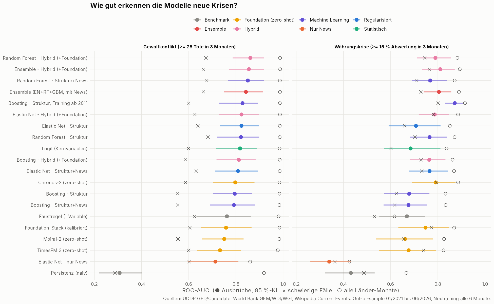
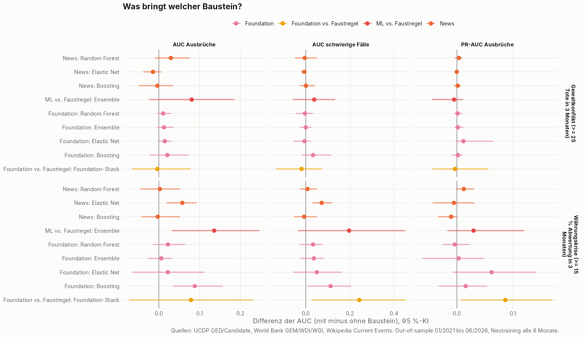

# Monatliches Frühwarnsystem (R + Foundation-Modelle)

Ein Frühwarnsystem auf **Monatsbasis** für 156 Länder, gebaut nur aus öffentlichen Daten. Es sagt für die
**nächsten 3 Monate** zwei Krisenarten voraus und vergleicht klassische Statistik, Machine Learning und
**vortrainierte Zeitreihen-Foundation-Modelle (TimesFM 3, Chronos-2, Moirai-2)**.

| Ziel | Definition | Quelle |
|---|---|---|
| **Gewaltkonflikt** | ≥ 25 Todesopfer organisierter Gewalt in den Monaten t+1 bis t+3 | UCDP GED + Candidate |
| **Währungskrise** | Abwertung ggü. USD um ≥ 15 % von t bis t+3 | World Bank Global Economic Monitor |

Bewertet wird vor allem die Erkennung von **Ausbrüchen**: Krisen in Ländern, die 12 Monate lang ruhig waren.
Zusätzlich wird ehrlich geprüft, ob die Modelle **mehr können als eine Faustregel** und wie sie bei den
**schwierigen Fällen** abschneiden: ruhige Länder, die schon Vorzeichen zeigen.

> Automatischer Bericht mit allen Tabellen und Grafiken: [`output/report.md`](output/report.md)
> Aktuelle Beobachtungslisten: `output/watchlist_conflict.csv`, `output/watchlist_fx.csv`

## Daten (alle öffentlich, ohne API-Schlüssel)

| Quelle | Inhalt | Aktualität |
|---|---|---|
| **UCDP GED + Candidate** | Jedes Gewaltereignis weltweit mit Datum, Koordinaten und Toten | monatlich, ca. 1 Monat Verzug |
| **World Bank GEM** | Monatlich: Wechselkurs, Preise, Reserven, Industrieproduktion, Aktienindex | 1–2 Monate Verzug |
| **World Bank WDI/WGI** | Jährlich: BIP pro Kopf, Bevölkerung, Kindersterblichkeit, Governance | jährlich |
| **Wikipedia „Current events“** | Täglicher Nachrichtenticker, 55'000+ Meldungen seit 2017 (Rubrik, Land, Tonalität) | tagesaktuell |
| **Hugging Face** | Vortrainierte Gewichte von TimesFM 3, Chronos-2, Moirai-2 (ca. 1.8 GB, einmalig) | – |
| GDELT (optional) | Tonalität der weltweiten Online-News | tagesaktuell, stark gedrosselt |

### Features (`R/04_build_panel.R`)

* **Konfliktgeschichte**: Tote und Ereignisse der letzten 1/3/12 Monate, nach Gewaltart, Trend, Monate seit letzter Krise
* **Räumlich (neu, aus den UCDP-Koordinaten)**:
  * Ausbreitung: Zahl der aktiven und der *neuen* Gewaltzonen (0,5°-Raster) im Land
  * Nachbarschaft: Tote in **anderen** Ländern im Umkreis von 500 km um die grössten Städte des Landes
* **Makro monatlich**: Wechselkursveränderung und -volatilität, Inflation, Reserven, Industrieproduktion, Börse
* **Struktur jährlich**: BIP pro Kopf, Bevölkerung, Kindersterblichkeit, Jugendanteil, politische Stabilität
* **News**: Zahl der Konflikt-, Politik-, Kriminalitäts- und Wirtschaftsmeldungen, Abweichung vom Normalniveau, Negativität
* **Foundation-Prognosen (neu)**: Krisenwahrscheinlichkeit aus TimesFM 3, Chronos-2 und Moirai-2

## Methoden (`R/05_models.R`, `py/foundation_forecasts.py`)

| Familie | Methode | Beschreibung |
|---|---|---|
| Benchmark | Persistenz | Basisrate je nach aktueller Lage |
| Benchmark | **Faustregel** | Logit mit **einer** Variable: Tote der letzten 12 Monate bzw. Inflation |
| Statistisch | Logit | 10 Kernvariablen |
| Regularisiert | Elastic Net | Struktur / nur News / Struktur+News |
| Machine Learning | Random Forest, Boosting | Struktur / Struktur+News; Boosting zusätzlich mit Training ab 2011 |
| Ensemble | Ensemble | Mittel aus Elastic Net, Random Forest, Boosting |
| **Foundation (zero-shot)** | **TimesFM 3** (Google, ~1.3 GB) | Decoder-only-Transformer, vortrainiert auf Milliarden Zeitpunkten |
| | **Chronos-2** (Amazon) | Transformer für Prognosen über viele Zeitreihen |
| | **Moirai-2** (Salesforce, small) | Universeller Transformer („Any-Variate Attention“) |
| | Foundation-Stack | Kalibrierte Kombination der drei (Logit auf Trainingsdaten) |
| **Hybrid** | EN / RF / Boosting / Ensemble + Foundation | ML-Modelle mit den Foundation-Prognosen als Zusatz-Features |

**Wie die Foundation-Modelle eingesetzt werden:** Sie sagen Zahlenreihen voraus, keine Ja/Nein-Ereignisse.
Jedes Modell bekommt pro Land die bisherige Monatsreihe (bis zu 16 Jahre Kontext):
- **Konflikt:** log(Tote der letzten 3 Monate)
- **Währung:** log(Wechselkurs)

Daraus sagt es die Quantile für Monat t+3 voraus, **ohne jedes Training auf unseren Daten**. Aus den Quantilen wird
die Wahrscheinlichkeit berechnet, dass die Krisenschwelle überschritten wird. Ausserhalb der Quantile helfen
exponentiell abfallende Ränder, damit die Rangfolge fein bleibt. Für jeden Monat sehen die Modelle nur die
Vergangenheit: 31'867 Prognosen pro Modell.

**Nicht umgesetzt:**
- **Lag-Llama**: nicht auf PyPI, wenig gepflegt.
- **Time-LLM**: kein Zero-shot-Modell, sondern ein Framework, das ein grosses Sprachmodell erst auf die Daten
  trainiert. Auf CPU ist das unrealistisch.
- **TimeGPT** (Nixtla): kostenpflichtige API. Das in deiner Liste genannte „TAM gen. one / TAMG GBT“ konnte ich
  nicht als existierendes Modell verifizieren; gemeint ist vermutlich TimeGPT.

**Evaluation (`R/06_evaluation.R`):** echte Out-of-sample-Prognosen 01/2021–06/2026 mit Neutraining alle 6 Monate.
Kennzahlen:
- AUC für Ausbrüche und für die **schwierigen Fälle**: Konflikt = ruhig, aber mindestens 1 Toter in 12 Monaten;
  Währung = mehr als 5 % Abwertung in 12 Monaten
- PR-AUC
- **Watchlist** (Top 20 der ruhigen Länder pro Monat): wie viele Ausbrüche standen vorher darauf, und der
  **Lift** gegenüber einer Zufallsauswahl
- Kalibrierung
- Länder-Cluster-Bootstrap für alle Konfidenzintervalle und Vergleiche

## Ergebnisse

### Gewaltkonflikt: 25 Ausbrüche im Testzeitraum

| Methode | AUC Ausbrüche (95 %-KI) | AUC schwierig | Ausbrüche auf Liste | Lift |
|---|---|---|---|---|
| **Ensemble – Hybrid (+Foundation)** | **0.86** (0.77–0.92) | 0.66 | 21/25 | 4.7 |
| Random Forest – Hybrid | 0.86 (0.79–0.92) | 0.67 | 19/25 | 4.3 |
| Ensemble (ohne Foundation) | 0.84 (0.75–0.91) | 0.66 | **22/25** | **4.9** |
| Logit (Kernvariablen) | 0.82 (0.72–0.89) | 0.60 | 19/25 | 4.3 |
| Chronos-2 (zero-shot) | 0.80 (0.70–0.88) | 0.59 | 18/25 | 4.0 |
| **Faustregel** (nur Tote der letzten 12 Monate) | 0.76 (0.63–0.86) | 0.62 | 19/25 | 4.3 |
| Moirai-2 (zero-shot) | 0.75 (0.66–0.83) | 0.55 | 20/25 | 4.5 |
| TimesFM 3 (zero-shot) | 0.73 (0.64–0.82) | 0.60 | 20/25 | 4.5 |

### Währungskrise: 36 Ausbrüche im Testzeitraum

| Methode | AUC Ausbrüche (95 %-KI) | AUC schwierig | PR-AUC | Ausbrüche auf Liste |
|---|---|---|---|---|
| **Boosting – Struktur, Training ab 2011** | **0.87** (0.83–0.91) | **0.80** | 0.11 | 25/36 |
| Ensemble – Hybrid (+Foundation) | 0.81 (0.73–0.87) | 0.76 | 0.07 | 21/36 |
| **Chronos-2 (zero-shot)** | 0.79 (0.69–0.88) | 0.79 | 0.09 | 26/36 |
| Foundation-Stack | 0.75 (0.63–0.85) | 0.77 | **0.12** | 25/36 |
| Ensemble (ohne Foundation) | 0.81 (0.74–0.86) | 0.73 | 0.06 | 19/36 |
| TimesFM 3 (zero-shot) | 0.68 (0.55–0.79) | 0.74 | 0.09 | 21/36 |
| Faustregel (nur Inflation) | 0.67 (0.55–0.75) | 0.53 | 0.03 | 13/36 |
| Moirai-2 (zero-shot) | 0.66 (0.54–0.78) | 0.66 | 0.04 | 20/36 |



### Was bringt welcher Baustein?



## Bewertung

**1. Bei Konflikten ist der Vorsprung gegenüber der Faustregel kleiner als gedacht.** Das beste Ensemble liegt
bei Ausbrüchen 0,08 AUC über der Faustregel „Tote der letzten 12 Monate“, das Konfidenzintervall
(−0,02 bis +0,19) schliesst null aber ein. Bei den schwierigen Fällen schaffen alle Modelle nur 0,55–0,68.
Welches unruhige Land kippt, sagt keine Methode zuverlässig voraus. Die Watchlist bleibt trotzdem nützlich:
Sie enthält 21–22 von 25 Ausbrüchen, fast 5-mal mehr als eine Zufallsauswahl, aber auch die Faustregel schafft 19.

**2. Bei Währungskrisen sind die Modelle klar besser als die Faustregel.** Boosting mit langer Historie
(0,87; schwierige Fälle 0,80) und das Ensemble schlagen die Faustregel „Inflation“ signifikant (+0,14).

**3. Foundation-Modelle zero-shot: beachtlich bei Währungen, mittelmässig bei Konflikten.**
* **Chronos-2** ist das klar beste der drei. Bei Währungskrisen erreicht es **ohne jedes Training** eine AUC von
  0,79 und bei schwierigen Fällen 0,79, praktisch gleich gut wie das beste ML-Modell. Es setzt 26 von 36 Ausbrüchen
  auf die Liste, der Spitzenwert aller Modelle. Wechselkurse sind „normale“ Zeitreihen mit Trends und
  Volatilitätsclustern, genau dafür sind diese Modelle trainiert.
* Bei **Konflikten** liegen die Foundation-Modelle allein auf Faustregel-Niveau (0,73–0,80). Gewaltausbrüche
  sind seltene Sprünge aus dem Nichts. Eine Reihe, die monatelang null ist, enthält kaum Information. Was fehlt,
  ist Kontext (Governance, Nachbarschaft, Wirtschaft), und den haben nur die ML-Modelle.
* **TimesFM 3**, das grösste Modell (1.3 GB), schneidet nicht besser ab als das kleine Moirai-2 (44 MB).
  Es braucht aber 16 statt 0,5 Minuten Rechenzeit. Grösse allein hilft hier nicht.

**4. Als Zusatz-Features (Hybrid) bringen die Foundation-Prognosen einen kleinen Gewinn.**
* **Boosting bei Währungskrisen** verbessert sich signifikant: +0,09 AUC bei Ausbrüchen, +0,11 bei schwierigen Fällen.
* Bei **Konflikten** steigt das Ensemble von 0,84 auf 0,86. Der Gewinn ist nicht gesichert.
* Im Hybrid-Random-Forest gehören die Foundation-Prognosen zu den **wichtigsten Variablen**: Moirai-2 ist
  bei Konflikten Nummer 1, Chronos-2 bei Währungen Nummer 2. Sie fassen die Dynamik einer Reihe kompakt zusammen.

**5. Räumliche Features:** Die Zahl der aktiven Gewaltzonen im Land ist der viertwichtigste
Konflikt-Indikator. Gewalt in Nachbarländern trägt nur wenig bei (Rang 19–21). Die Gesamtleistung ändert
sich dadurch kaum.

**6. Die Nachrichtendaten** bringen weiterhin nur wenig. Einzig beim Elastic Net für Währungskrisen gibt es
einen gesicherten Gewinn (+0,06).

### Empfehlung

| Einsatz | Modell |
|---|---|
| Konflikt-Watchlist | **Ensemble (mit oder ohne Foundation)**. Unterschiede im Rauschen; die Faustregel als Plausibilitätscheck daneben |
| Währungs-Watchlist | **Boosting mit langer Historie**, ergänzt durch **Chronos-2** als unabhängige zweite Meinung |
| Wenn wenig Rechenzeit | **Chronos-2** statt TimesFM 3: besser und 4-mal schneller |

Die grösste Schwäche bleibt die **kleine Zahl an Ausbrüchen** (25 bzw. 36). Die Konfidenzintervalle sind breit,
und die meisten Rangunterschiede sind nicht gesichert.

## Grenzen

* **Datenverzug**: Die UCDP-Candidate-Daten erscheinen etwa 1 Monat später, die Makrodaten 1–2 Monate. Im
  Echtbetrieb ist der Vorsprung kleiner als in der Evaluation.
* Die Foundation-Modelle sehen nur je **eine Reihe**. TimesFM 3 und Chronos-2 könnten auch Zusatzvariablen
  verarbeiten; das wäre eine sinnvolle Erweiterung.
* Länder **ohne aktuelle Wechselkursdaten** (z. B. Sudan, Iran, Syrien) fehlen in der Währungs-Watchlist.
* Die Ländererkennung im Nachrichtentext arbeitet mit einem Wörterbuch. Wikipedia ist englischsprachig und westlich geprägt.

## Ausführen

### 1. R-Pakete

```r
install.packages(c("dplyr", "tidyr", "purrr", "stringr", "readr", "jsonlite", "ggplot2", "patchwork",
                   "countrycode", "glmnet", "ranger", "gbm", "pROC", "tidytext", "zoo", "maps"))
```

### 2. Python für die Foundation-Modelle (optional, empfohlen)

Benötigt wird **Python 3.11** (wegen Moirai-2). Ohne Python läuft alles ausser den Foundation- und
Hybrid-Modellen. Die Pakete gehören in den Ordner `.venv` im Projektordner, R findet sie dort automatisch.

Windows (Eingabeaufforderung im Ordner `early_warning_monthly`):

```bash
py -3.11 -m venv .venv
```

```bash
.venv\Scripts\python -m pip install -r py\requirements.txt
```

macOS/Linux:

```bash
python3.11 -m venv .venv && .venv/bin/python -m pip install -r py/requirements.txt
```

Beim ersten Lauf werden die Modellgewichte von Hugging Face geladen (ca. 1.8 GB). Die Prognosen dauern auf
einem normalen Laptop etwa 20–40 Minuten (davon TimesFM 3 den grössten Teil) und werden danach gecacht.
Ein anderer Interpreter lässt sich mit `FM_PYTHON=...` angeben, `USE_FM=0` schaltet die Foundation-Modelle ab.

### 3. Pipeline starten

In RStudio `run_all.R` öffnen und **Source** klicken, oder:

```bash
Rscript run_all.R
```

* Der erste Lauf dauert ca. 60 Minuten, Folgeläufe ca. 3 Minuten.
* `RISK_REFRESH=1` lädt alle Daten neu und rechnet alles neu (monatliches Update).

Automatisch und kostenlos per GitHub Actions: `.github/workflows/update-early-warning.yml` (monatlich am 22.,
mit Python-Umgebung und Cache der Modellgewichte).

### Struktur

```
run_all.R                    Pipeline
R/00_config.R                Parameter (Horizont, Schwellen, Testzeitraum)
R/01_fetch_worldbank.R       GEM-Monatsdaten + jährliche WDI/WGI-Struktur
R/02_fetch_ucdp.R            UCDP -> Tote pro Land und Monat + räumliche Features
R/03_fetch_news.R            Wikipedia Current Events -> Text Mining
R/03b_fetch_gdelt.R          GDELT (optional)
R/04_build_panel.R           Länder-Monats-Panel, Zielvariablen, Features
R/04b_foundation.R           Ruft py/foundation_forecasts.py auf, liest die Zero-shot-Prognosen ein
R/05_models.R                20 Methoden, Rolling-Origin-Evaluation, Beobachtungslisten
R/06_evaluation.R            Kennzahlen, Bootstrap, Mehrwert der Bausteine
R/07_report.R                Grafiken und output/report.md
py/foundation_forecasts.py   TimesFM 3, Chronos-2, Moirai-2 (zero-shot, Quantile -> Wahrscheinlichkeit)
py/requirements.txt          Python-Pakete
```
