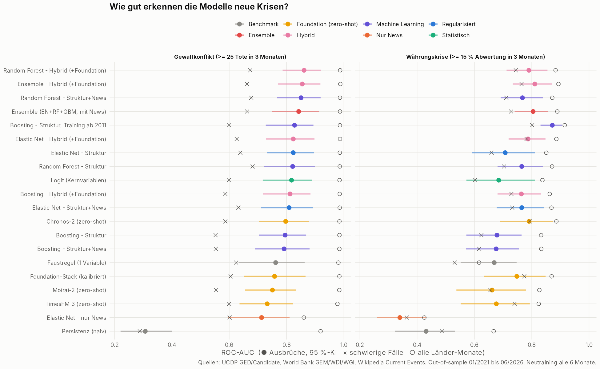
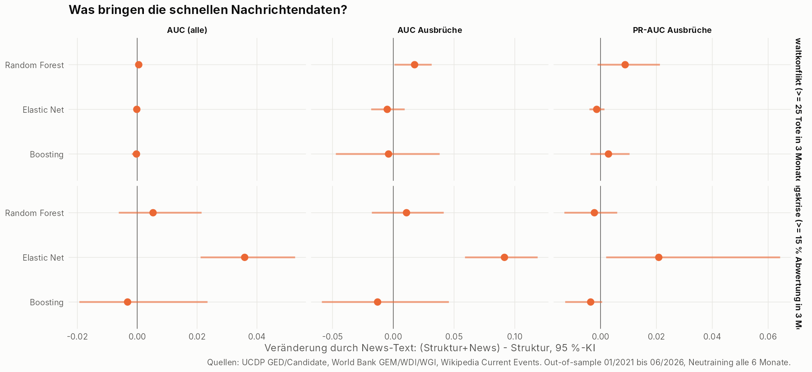
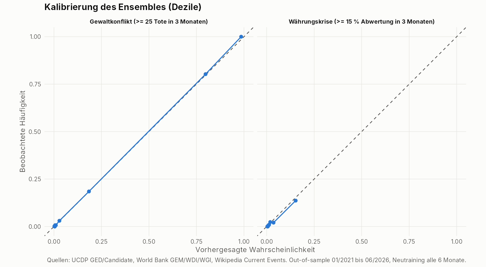
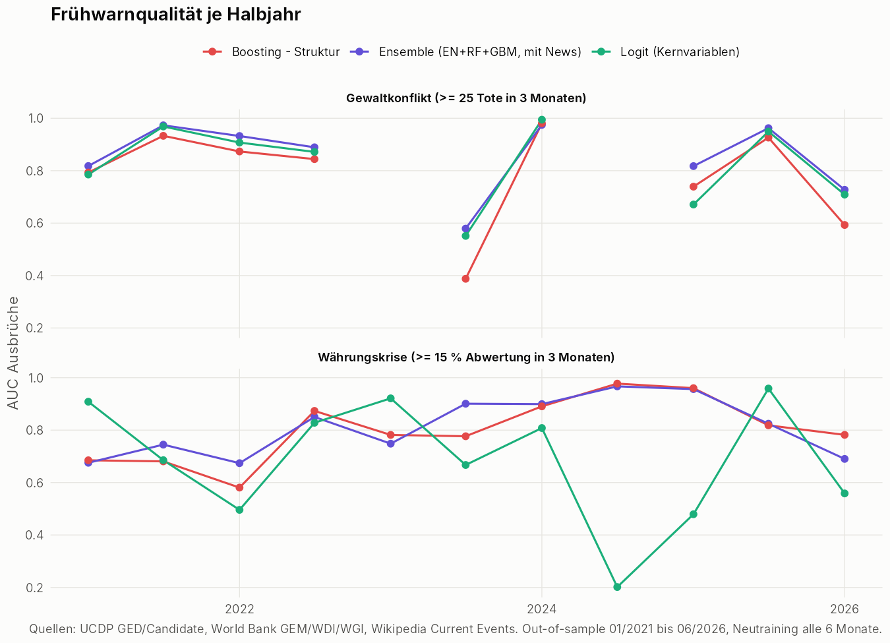
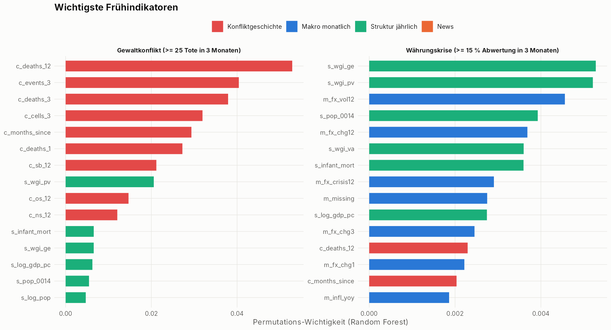
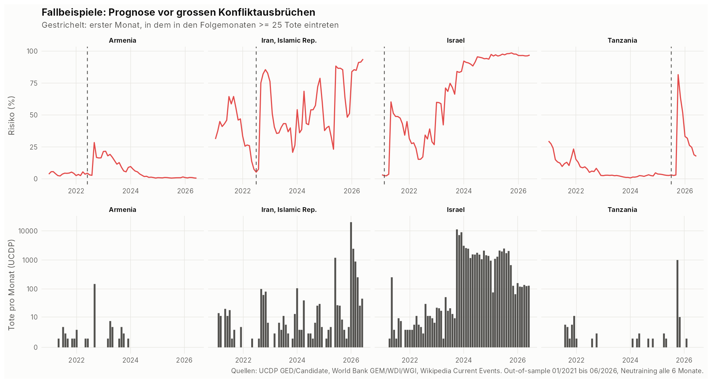
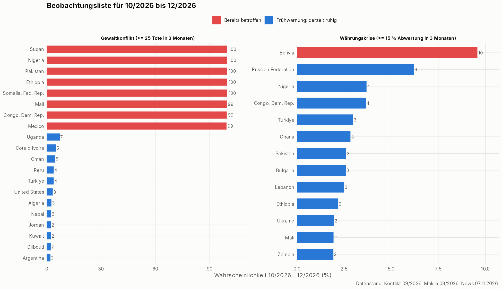

# Monatliches Frühwarnsystem - automatischer Evaluationsbericht

_Erzeugt am 07.11.2026. Alle Kennzahlen sind echte Out-of-sample-Werte: Testmonate 01/2021 bis 06/2026, Neutraining alle 6 Monate._

## Datengrundlage

* 156 Länder (>= 1 Mio. Einwohner), Monatsdaten 01/2011 bis 09/2026
* Features: 31 strukturierte (Konflikt, Makro monatlich, Struktur) + 18 News-Features
* Testdaten Konflikt: 10296 Länder-Monate, davon 63 Ausbruchs-Monate in 25 Episoden
* Testdaten Währung: 9391 Länder-Monate, davon 72 Ausbruchs-Monate in 36 Episoden

## Gewaltkonflikt

| Rang | Methode | AUC Ausbrüche | KI | PR-AUC Ausbrüche | Ausbrüche auf Liste | Treffer Liste | AUC alle | Brier | BSS | Kal.-Steigung |
|---|---|---|---|---|---|---|---|---|---|---|
|  1 | Ensemble (EN+RF+GBM, mit News) | 0.851 | 0.76-0.91 | 0.048 | 20/25 | 0.033 | 0.987 | 0.030 | 0.812 | 1.113 |
|  2 | Random Forest - Struktur+News | 0.857 | 0.77-0.92 | 0.049 | 21/25 | 0.034 | 0.987 | 0.031 | 0.808 | 1.164 |
|  3 | Boosting - Struktur, Training ab 2011 | 0.800 | 0.68-0.89 | 0.046 | 20/25 | 0.032 | 0.986 | 0.031 | 0.812 | 1.014 |
|  4 | Elastic Net - Struktur | 0.813 | 0.71-0.89 | 0.051 | 20/25 | 0.033 | 0.986 | 0.031 | 0.807 | 1.114 |
|  5 | Elastic Net - Struktur+News | 0.808 | 0.70-0.89 | 0.049 | 20/25 | 0.033 | 0.986 | 0.031 | 0.807 | 1.111 |
|  6 | Logit (Kernvariablen) | 0.818 | 0.72-0.89 | 0.048 | 19/25 | 0.030 | 0.985 | 0.033 | 0.798 | 0.972 |
|  7 | Random Forest - Struktur | 0.840 | 0.76-0.91 | 0.040 | 18/25 | 0.033 | 0.986 | 0.031 | 0.808 | 1.127 |
|  8 | Boosting - Struktur+News | 0.781 | 0.67-0.87 | 0.034 | 18/25 | 0.029 | 0.984 | 0.032 | 0.801 | 0.924 |
|  9 | Boosting - Struktur | 0.785 | 0.68-0.86 | 0.031 | 16/25 | 0.027 | 0.984 | 0.032 | 0.801 | 0.922 |
| 10 | Persistenz (naiv) | 0.307 | 0.22-0.40 | 0.006 | 9/25 | 0.008 | 0.919 | 0.044 | 0.729 | 0.992 |
| 11 | Elastic Net - nur News | 0.713 | 0.60-0.81 | 0.030 | 12/25 | 0.023 | 0.860 | 0.101 | 0.376 | 1.031 |

## Währungskrise

| Rang | Methode | AUC Ausbrüche | KI | PR-AUC Ausbrüche | Ausbrüche auf Liste | Treffer Liste | AUC alle | Brier | BSS | Kal.-Steigung |
|---|---|---|---|---|---|---|---|---|---|---|
|  1 | Boosting - Struktur, Training ab 2011 | 0.873 | 0.83-0.90 | 0.112 | 25/36 | 0.033 | 0.915 | 0.015 | 0.224 | 1.105 |
|  2 | Ensemble (EN+RF+GBM, mit News) | 0.812 | 0.76-0.86 | 0.069 | 20/36 | 0.027 | 0.893 | 0.017 | 0.158 | 1.164 |
|  3 | Random Forest - Struktur+News | 0.773 | 0.70-0.84 | 0.064 | 19/36 | 0.024 | 0.875 | 0.018 | 0.118 | 0.924 |
|  4 | Random Forest - Struktur | 0.763 | 0.67-0.84 | 0.066 | 20/36 | 0.025 | 0.869 | 0.018 | 0.116 | 0.901 |
|  5 | Boosting - Struktur | 0.708 | 0.59-0.79 | 0.044 | 17/36 | 0.025 | 0.843 | 0.017 | 0.137 | 0.848 |
|  6 | Elastic Net - Struktur+News | 0.763 | 0.67-0.84 | 0.038 | 21/36 | 0.029 | 0.868 | 0.018 | 0.075 | 1.173 |
|  7 | Boosting - Struktur+News | 0.695 | 0.59-0.77 | 0.040 | 17/36 | 0.021 | 0.839 | 0.017 | 0.137 | 0.838 |
|  8 | Logit (Kernvariablen) | 0.685 | 0.57-0.81 | 0.041 | 13/36 | 0.020 | 0.837 | 0.019 | 0.049 | 0.896 |
|  9 | Elastic Net - Struktur | 0.671 | 0.58-0.77 | 0.017 | 14/36 | 0.022 | 0.832 | 0.020 | 0.015 | 0.946 |
| 10 | Persistenz (naiv) | 0.431 | 0.32-0.53 | 0.014 | 15/36 | 0.015 | 0.667 | 0.018 | 0.073 | 1.131 |
| 11 | Elastic Net - nur News | 0.340 | 0.26-0.43 | 0.006 | 5/36 | 0.005 | 0.425 | 0.020 | -0.002 | -1.187 |

_Ausbrüche = Länder, die in den 12 Monaten davor unter der Schwelle lagen. 'Ausbrüche auf Liste' = Episoden, bei denen das Land vorher mindestens einmal unter den Top 20 der ruhigen Länder stand. 'Treffer Liste' = Anteil der Listenplätze mit tatsächlichem Ausbruch._

## Mehrwert der Nachrichtendaten (Wikipedia Current Events)

| Ziel | Methode | Metrik | Delta | KI unten | KI oben | P(Delta>0) |
|---|---|---|---|---|---|---|
| Gewaltkonflikt (>= 25 Tote in 3 Monaten) | enet | AUC (alle) | -0.000 | -0.000 | 0.000 | 0.295 |
| Gewaltkonflikt (>= 25 Tote in 3 Monaten) | enet | AUC Ausbrüche | -0.005 | -0.018 | 0.009 | 0.265 |
| Gewaltkonflikt (>= 25 Tote in 3 Monaten) | enet | PR-AUC Ausbrüche | -0.001 | -0.004 | 0.001 | 0.150 |
| Gewaltkonflikt (>= 25 Tote in 3 Monaten) | rf | AUC (alle) | 0.001 | 0.000 | 0.001 | 0.980 |
| Gewaltkonflikt (>= 25 Tote in 3 Monaten) | rf | AUC Ausbrüche | 0.018 | 0.001 | 0.032 | 0.975 |
| Gewaltkonflikt (>= 25 Tote in 3 Monaten) | rf | PR-AUC Ausbrüche | 0.009 | -0.001 | 0.021 | 0.955 |
| Gewaltkonflikt (>= 25 Tote in 3 Monaten) | gbm | AUC (alle) | -0.000 | -0.002 | 0.001 | 0.425 |
| Gewaltkonflikt (>= 25 Tote in 3 Monaten) | gbm | AUC Ausbrüche | -0.004 | -0.047 | 0.038 | 0.495 |
| Gewaltkonflikt (>= 25 Tote in 3 Monaten) | gbm | PR-AUC Ausbrüche | 0.003 | -0.004 | 0.010 | 0.875 |
| Währungskrise (>= 15 % Abwertung in 3 Monaten) | enet | AUC (alle) | 0.036 | 0.021 | 0.053 | 1.000 |
| Währungskrise (>= 15 % Abwertung in 3 Monaten) | enet | AUC Ausbrüche | 0.091 | 0.059 | 0.119 | 1.000 |
| Währungskrise (>= 15 % Abwertung in 3 Monaten) | enet | PR-AUC Ausbrüche | 0.021 | 0.002 | 0.064 | 0.985 |
| Währungskrise (>= 15 % Abwertung in 3 Monaten) | rf | AUC (alle) | 0.005 | -0.006 | 0.022 | 0.840 |
| Währungskrise (>= 15 % Abwertung in 3 Monaten) | rf | AUC Ausbrüche | 0.011 | -0.018 | 0.042 | 0.770 |
| Währungskrise (>= 15 % Abwertung in 3 Monaten) | rf | PR-AUC Ausbrüche | -0.002 | -0.013 | 0.006 | 0.310 |
| Währungskrise (>= 15 % Abwertung in 3 Monaten) | gbm | AUC (alle) | -0.003 | -0.019 | 0.023 | 0.370 |
| Währungskrise (>= 15 % Abwertung in 3 Monaten) | gbm | AUC Ausbrüche | -0.013 | -0.059 | 0.046 | 0.335 |
| Währungskrise (>= 15 % Abwertung in 3 Monaten) | gbm | PR-AUC Ausbrüche | -0.004 | -0.013 | 0.001 | 0.055 |

## Diagnostik

## Beobachtungsliste 10/2026 bis 12/2026

### Gewaltkonflikt - Frühwarnung (derzeit ruhige Länder)

| Land | Region | Risiko Ensemble | Elastic Net | Random Forest | Boosting |
|---|---|---|---|---|---|
| Uganda | Sub-Saharan Africa  | 0.072 | 0.069 | 0.073 | 0.074 |
| Cote d'Ivoire | Sub-Saharan Africa  | 0.051 | 0.023 | 0.088 | 0.041 |
| Oman | Middle East, North Africa, Afghanistan & Pakistan | 0.046 | 0.016 | 0.095 | 0.026 |
| Peru | Latin America & Caribbean  | 0.038 | 0.032 | 0.057 | 0.027 |
| Turkiye | Europe & Central Asia | 0.038 | 0.066 | 0.021 | 0.028 |
| United States | North America | 0.033 | 0.025 | 0.050 | 0.023 |
| Algeria | Middle East, North Africa, Afghanistan & Pakistan | 0.026 | 0.031 | 0.011 | 0.035 |
| Nepal | South Asia | 0.025 | 0.015 | 0.050 | 0.010 |
| Jordan | Middle East, North Africa, Afghanistan & Pakistan | 0.023 | 0.014 | 0.048 | 0.008 |
| Kuwait | Middle East, North Africa, Afghanistan & Pakistan | 0.023 | 0.018 | 0.035 | 0.016 |
| Djibouti | Middle East, North Africa, Afghanistan & Pakistan | 0.022 | 0.017 | 0.029 | 0.020 |
| Argentina | Latin America & Caribbean  | 0.020 | 0.017 | 0.022 | 0.022 |
| Dominican Republic | Latin America & Caribbean  | 0.019 | 0.024 | 0.009 | 0.024 |
| United Arab Emirates | Middle East, North Africa, Afghanistan & Pakistan | 0.019 | 0.013 | 0.022 | 0.022 |
| Spain | Europe & Central Asia | 0.016 | 0.015 | 0.026 | 0.008 |

### Währungskrise - Frühwarnung (derzeit ruhige Länder)

| Land | Region | Risiko Ensemble | Elastic Net | Random Forest | Boosting |
|---|---|---|---|---|---|
| Russian Federation | Europe & Central Asia | 0.062 | 0.012 | 0.112 | 0.062 |
| Nigeria | Sub-Saharan Africa  | 0.037 | 0.020 | 0.057 | 0.034 |
| Congo, Dem. Rep. | Sub-Saharan Africa  | 0.037 | 0.028 | 0.057 | 0.025 |
| Turkiye | Europe & Central Asia | 0.030 | 0.012 | 0.049 | 0.029 |
| Ghana | Sub-Saharan Africa  | 0.028 | 0.011 | 0.063 | 0.011 |
| Pakistan | Middle East, North Africa, Afghanistan & Pakistan | 0.026 | 0.013 | 0.058 | 0.007 |
| Bulgaria | Europe & Central Asia | 0.026 | 0.007 | 0.045 | 0.025 |
| Lebanon | Middle East, North Africa, Afghanistan & Pakistan | 0.025 | 0.014 | 0.050 | 0.011 |
| Ethiopia | Sub-Saharan Africa  | 0.022 | 0.024 | 0.032 | 0.010 |
| Ukraine | Europe & Central Asia | 0.020 | 0.012 | 0.018 | 0.030 |
| Mali | Sub-Saharan Africa  | 0.019 | 0.016 | 0.033 | 0.009 |
| Zambia | Sub-Saharan Africa  | 0.019 | 0.016 | 0.030 | 0.013 |
| Argentina | Latin America & Caribbean  | 0.019 | 0.017 | 0.032 | 0.008 |
| United Arab Emirates | Middle East, North Africa, Afghanistan & Pakistan | 0.018 | 0.014 | 0.035 | 0.005 |
| Malawi | Sub-Saharan Africa  | 0.015 | 0.016 | 0.021 | 0.007 |
