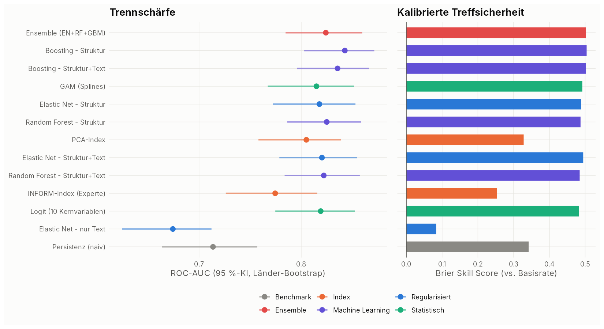
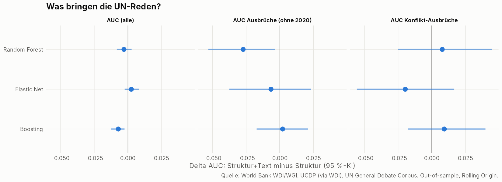
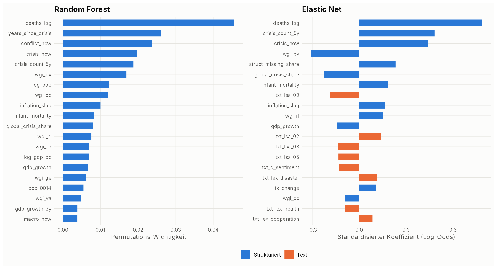
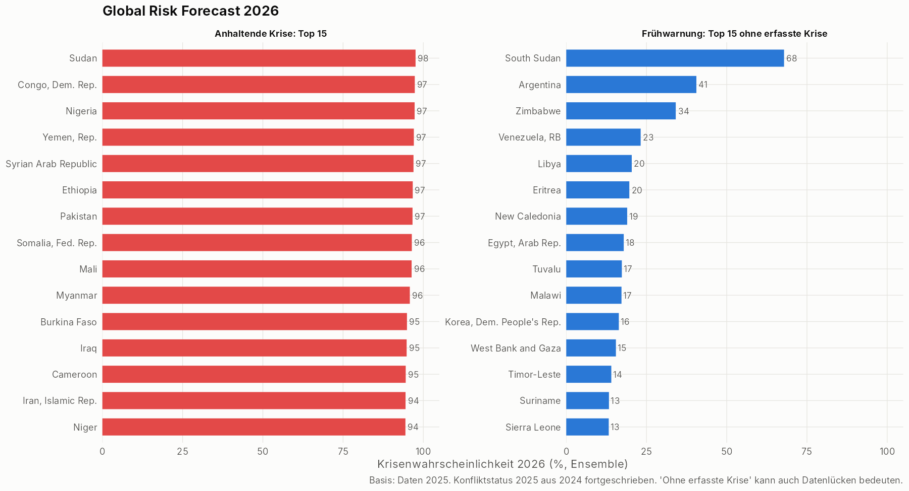

# Global Risk Model (R)

Ein Frühwarnmodell für **Länderrisiken weltweit**, gebaut nur aus öffentlichen Daten.
Es kombiniert strukturierte Indikatoren der Weltbank mit **Textdaten aus 6'291 Reden vor der
UN-Generalversammlung**. 13 Methoden werden streng out-of-sample verglichen und bewertet.

> Automatisch erzeugter Bericht mit allen Tabellen und Grafiken: [`output/report.md`](output/report.md)

## Fragestellung

**Wie wahrscheinlich ist es, dass ein Land im nächsten Jahr in eine Krise gerät?**

Eine Krise in Jahr *t+1* liegt vor, wenn mindestens eines eintritt:

| Krisentyp | Definition | Quelle |
|---|---|---|
| Gewaltsamer Konflikt | ≥ 25 kampfbezogene Todesopfer | UCDP via World Bank (`VC.BTL.DETH`) |
| Wirtschaftseinbruch | reales BIP-Wachstum < −3 % | World Bank (`NY.GDP.MKTP.KD.ZG`) |
| Inflationskrise | Inflation > 30 % | World Bank (`FP.CPI.TOTL.ZG`) |

Panel: 6'572 Länder-Jahre, 210 Länder, 1991–2023. Basisrate 23,7 %.

## Daten (alle öffentlich, per API/Skript geladen)

| Quelle | Inhalt | Variablen |
|---|---|---|
| World Bank WDI API | Makro, Demografie, Konflikt | 19 Indikatoren, z. B. BIP, Inflation, Wechselkurs, Reserven, Auslandsschuld, Kindersterblichkeit, Jugendanteil, Militärausgaben, Mordrate |
| World Bank WGI API | Governance | Politische Stabilität, Regierungseffektivität, Rechtsstaat, Korruptionskontrolle, Mitsprache, Regulierungsqualität |
| **UN General Debate Corpus** (Baturo, Dasandi & Mikhaylov, CC0) | **Text**: jährliche Rede jedes Staates vor der UN-Generalversammlung | 6'291 Reden 1989–2022 → 30 Text-Features |

Abgeleitete Features (36 strukturiert): Krisenhistorie (Jahre seit der letzten Krise, Krisen der letzten 5 Jahre),
regionale Ansteckung (Krisenanteil der Nachbarregion ohne das eigene Land), globaler Krisenanteil,
Wechselkursschock, Inflationsdynamik, Veränderung der politischen Stabilität und Datenlücken-Anteil.

### Text Mining der UN-Reden (`R/03_text_features.R`)

1. **Sentiment**: Bing-Liu-Lexikon (tidytext), Netto-Tonalität und Negativität
2. **Risiko-Wörterbücher**: Treffer pro 1'000 Wörter für Konflikt, Terrorismus, Wirtschaftsstress,
   Humanitäres, Naturkatastrophen/Klima, Gesundheit, Instabilität und Kooperation
3. **Latent Semantic Analysis**: TF-IDF und truncated SVD (`irlba`) mit 15 latenten Themen-Dimensionen.
   Diese werden **nur auf Reden bis 2009 gefittet** und auf spätere Reden projiziert, damit keine Information aus der Zukunft einfliesst.
4. **Dynamik**: Veränderung von Sentiment und Konflikt-Vokabular gegenüber dem Vorjahr

## Methoden (`R/05_models.R`)

| Familie | Methode | Idee |
|---|---|---|
| Benchmark | Persistenz | „Krise bleibt Krise“: P(Krise \| Krise heute) |
| Index | INFORM-Index | Experten-Composite nach INFORM-Logik: geometrisches Mittel aus Hazard × Vulnerabilität × fehlender Bewältigungskapazität |
| Index | PCA-Index | Datengetriebene Gewichte aus der 1. Hauptkomponente |
| Statistisch | Logit | Klassische logistische Regression mit 10 Kernvariablen |
| Statistisch | GAM | Nichtlineare Effekte über Splines (`mgcv`) |
| Regularisiert | Elastic Net | glmnet, alpha = 0,5, CV mit Länder-Folds, je nur Struktur, nur Text, Struktur+Text |
| Machine Learning | Random Forest | ranger, 500 Bäume, je Struktur und Struktur+Text |
| Machine Learning | Gradient Boosting | gbm, 600 Bäume, Tiefe 3, je Struktur und Struktur+Text |
| Ensemble | Ensemble | Mittel aus Elastic Net, Random Forest und Boosting (je Struktur+Text) |

Die Indizes werden über eine logistische Kalibrierung auf dem Trainingsfenster in Wahrscheinlichkeiten übersetzt.

### Evaluationsdesign (`R/06_evaluation.R`)

* **Rolling Origin mit expandierendem Fenster**: Für jedes Testjahr *T* = 2010 … 2023 wird nur mit Daten bis *T−1* trainiert
  (deren Ergebnis *T* ist zum Zeitpunkt *T* bekannt). Daraus entstehen 2'864 echte Out-of-sample-Prognosen pro Methode.
* Auch Imputation (Median) und Standardisierung werden nur mit Trainingsdaten berechnet. Fehlende Werte werden innerhalb
  eines Landes maximal 3 Jahre fortgeschrieben, und nur aus der Vergangenheit.
* **Kennzahlen**: ROC-AUC, PR-AUC, AUC für *Ausbrüche* (Länder ohne aktuelle Krise, ohne das Pandemie-Ereignisjahr 2020),
  AUC für *Konflikt-Ausbrüche*, Brier Score, Brier Skill Score, Log-Loss, Kalibrierungs-Steigung und Recall der Top-10-%-Warnliste pro Jahr
* **Unsicherheit**: Cluster-Bootstrap über Länder (300 Replikationen, gepaart) und DeLong-Test gegen das Logit
* **Gesamtrang**: Mittel der Ränge aus 7 Kriterien

## Ergebnisse und Bewertung

| Rang | Methode | AUC | AUC Ausbrüche* | AUC Konflikt-Ausbr. | Brier Skill | Kal.-Steigung |
|---|---|---|---|---|---|---|
| 1 | Ensemble (EN+RF+GBM) | 0.824 | **0.699** | 0.740 | 0.502 | 1.04 |
| 2 | Boosting – Struktur | **0.843** | 0.678 | 0.727 | **0.504** | 0.98 |
| 3 | Boosting – Struktur+Text | 0.836 | 0.680 | 0.736 | 0.502 | 0.99 |
| 4 | GAM (Splines) | 0.815 | 0.681 | 0.770 | 0.492 | 0.99 |
| 5 | Elastic Net – Struktur | 0.818 | 0.677 | 0.730 | 0.489 | 1.01 |
| 6 | Random Forest – Struktur | 0.825 | 0.697 | 0.686 | 0.487 | 0.85 |
| 7 | PCA-Index | 0.805 | 0.690 | **0.841** | 0.328 | 0.99 |
| 10 | INFORM-Index (Experte) | 0.775 | 0.671 | 0.777 | 0.253 | 1.01 |
| 11 | Logit (10 Kernvariablen) | 0.819 | 0.674 | 0.703 | 0.482 | 0.97 |
| 12 | Elastic Net – nur Text | 0.674 | 0.592 | 0.743 | 0.083 | 1.07 |
| 13 | Persistenz (naiv) | 0.714 | 0.505 | 0.453 | 0.342 | 0.92 |

\* Länder ohne aktuelle Krise, ohne das Pandemie-Ereignisjahr 2020. Vollständige Tabelle in `output/report.md`.



### Bewertung der Methoden

1. **Gradient Boosting und Ensemble liefern die besten Gesamtergebnisse.** Boosting hat die höchste AUC (0,843) und ist
   im DeLong-Test signifikant besser als das Logit (p < 0,001). Das Ensemble ist am robustesten: Es ist überall unter den
   besten Methoden, perfekt kalibriert und am besten bei Ausbrüchen. **Empfehlung für den Betrieb: das Ensemble.**
2. **Der Abstand zwischen guter Statistik und Machine Learning ist klein.** Logit, GAM und Elastic Net liegen bei einer AUC
   von 0,815–0,820, nur rund 0,02 hinter Boosting, und die Konfidenzintervalle überlappen stark. Für Kommunikation und
   Erklärbarkeit ist ein Logit oder GAM daher eine sehr vertretbare Wahl.
3. **Indizes sind gut im Ranking, aber schlecht kalibriert.** INFORM- und PCA-Index haben deutlich schlechtere Brier-Werte.
   Dafür sind sie bei **Konflikt-Ausbrüchen** am stärksten (PCA 0,84, INFORM 0,78): Strukturelle Fragilität (Governance,
   Armut) erkennt neue Konflikte besser als Modelle, die stark auf Krisenhistorie setzen. Das ist ein klassisches
   Argument für die Kombination beider Ansätze.
4. **Die naive Persistenz ist ein ernstzunehmender Benchmark.** Schon „Krise bleibt Krise“ erreicht eine AUC von 0,71.
   Echter Mehrwert eines Modells zeigt sich erst bei den **Ausbrüchen**: Dort fällt die Persistenz auf 0,5, die Modelle erreichen 0,67–0,70.
5. **Strukturbruch 2020:** Die Pandemie (68 % der Länder in Krise) ist mit länderspezifischen Daten nicht vorhersagbar.
   Inklusive 2020 sinkt die Ausbruchs-AUC aller Modelle auf rund 0,5. Globale Schocks brauchen andere Instrumente
   (Szenarien, Stresstests), siehe `output/figures/04_auc_by_year.png`.

### Was bringen die Textdaten?



* **Allein tragen die Reden echtes Signal.** Ein reines Textmodell erreicht eine AUC von 0,67 und bei Konflikt-Ausbrüchen
  0,74. Das ist besser als das Logit mit harten Daten (0,70). Die Sprache vor der UN, also Konfliktvokabular, Tonalität
  und Themen, verrät viel über die Lage eines Landes.
* **Zusätzlich zu den strukturierten Daten bringen sie aber praktisch nichts.** Alle Deltas liegen im Bereich von ±0,03,
  und die Konfidenzintervalle schliessen 0 meist ein. Bei Boosting ist die Gesamt-AUC mit Text sogar leicht
  schlechter (−0,007, mehr Rauschen durch 30 zusätzliche Variablen). Die Textinformation ist weitgehend **redundant** zu
  Konfliktopfern, Governance und Krisenhistorie.
* **Einordnung:** Jährliche, diplomatisch formulierte Reden sind ein langsames Signal. Mehrwert wäre eher von hochfrequenten
  Texten zu erwarten (Nachrichten, z. B. GDELT, oder humanitäre Lageberichte von ReliefWeb).
* Die LSA-Dimensionen erfassen vor allem **Regionen und Themen** (z. B. Nahost/Golf, Westafrika, Pazifikinseln, Balkan),
  siehe Tabelle in `output/report.md`. Die globale Zeitreihe des Konfliktvokabulars zeigt 2022 (Ukraine) einen
  deutlichen Sprung (`output/figures/07_global_text_risk.png`).

### Wichtigste Treiber



Konfliktopfer, Krisenhistorie und politische Stabilität (WGI) dominieren. Danach folgen Inflation, Kindersterblichkeit
als Armutsproxy und Datenlücken: Fehlende Statistik ist selbst ein Risikosignal.

### Prognose 2026



Vollständige Liste: `output/forecast_2026.csv`. Die Frühwarnliste (Länder ohne erfasste Krise 2025) führen Südsudan,
Argentinien, Simbabwe und Venezuela an. Das sind Länder mit Inflations- oder Konfliktgeschichte, die aktuell unter
den Schwellen liegen oder Datenlücken haben.

## Grenzen

* **Text bis 2022**: Verwendet wird eine öffentliche CC0-Kopie des Korpus auf GitHub (Reden 1946–2022). Für 2023/2024
  werden Text-Features bis zu 2 Jahre fortgeschrieben, danach imputiert. Mit dem offiziellen Dataverse-Archiv
  (1946–2025, Guestbook-Eintrag nötig) wird das automatisch genutzt (siehe unten).
* **Konfliktdaten bis 2024**: Für die Prognose 2026 wird der Konfliktstatus 2025 aus 2024 fortgeschrieben.
* Der Refugee-Indikator der Weltbank (`SM.POP.REFG.OR`) ist inzwischen archiviert und nicht mehr per API verfügbar.
* Erfasst werden nur Krisen, die in den Daten sichtbar sind. Länder mit grossen Datenlücken (z. B. Südsudan, Eritrea)
  können als „ohne Krise“ erscheinen. Gewalt, die UCDP einem anderen Staat zuordnet (z. B. Gaza), fehlt im Konfliktsignal.
* Die Krisendefinition ist breit (Konflikt **oder** Makrokrise). Separate Zielvariablen pro Krisentyp wären eine sinnvolle Erweiterung.

## Ausführen

Voraussetzungen: R ≥ 4.3, `git` und Internetzugang zu `api.worldbank.org` und `github.com`.

```r
install.packages(c("dplyr", "tidyr", "purrr", "stringr", "jsonlite", "httr", "Matrix", "ggplot2",
                   "patchwork", "glmnet", "ranger", "gbm", "mgcv", "pROC", "irlba", "tidytext",
                   "tokenizers", "zoo"))
```

```bash
Rscript run_all.R
```

Die Laufzeit beträgt rund 6 Minuten. Rohdaten werden in `data/` gecacht. `RISK_REFRESH=1` lädt alles neu.

**Offizielles UNGDC-Archiv (1946–2025) statt der GitHub-Kopie:** `UNGDC_1946-2025.tar.gz` von
<https://doi.org/10.7910/DVN/0TJX8Y> herunterladen und nach `data/raw/` legen, dann `RISK_REFRESH=1` setzen. Alternativ
setzt man `UNGDC_NAME`, `UNGDC_EMAIL`, `UNGDC_INSTITUTION` und `UNGDC_POSITION`, dann wird der Guestbook-Eintrag per API übermittelt.

### Struktur

```
run_all.R                 Pipeline
R/00_config.R             Pakete, Parameter, Grafik-Theme
R/01_fetch_worldbank.R    WDI- und WGI-Abruf über die World-Bank-API
R/02_fetch_ungdc.R        UN-Reden (Dataverse oder GitHub-Kopie)
R/03_text_features.R      Sentiment, Risiko-Wörterbücher, LSA
R/04_build_panel.R        Panel, Zielvariable, Feature Engineering
R/05_models.R             13 Methoden, Rolling-Origin-Evaluation, finale Prognose
R/06_evaluation.R         Kennzahlen, Bootstrap, DeLong, Ranking
R/07_report.R             Grafiken und output/report.md
output/                   Bericht, Grafiken, CSV (Evaluation, Prognose)
```

## Automatische Aktualisierung (GitHub Actions)

Der Workflow `.github/workflows/update-risk-model.yml` rechnet das Modell **monatlich** (am 3., 04:17 UTC) komplett neu:
Daten laden, Modelle trainieren, evaluieren und Bericht, Grafiken und Prognose zurück ins Repo committen.
Ein Lauf dauert rund 10–15 Minuten. Das ist kostenlos: Öffentliche Repos haben unbegrenzte Minuten,
private Repos 2'000 Gratisminuten pro Monat.

Einrichten:
1. Den Workflow in den **Default-Branch** mergen. Zeitgesteuerte Läufe startet GitHub nur von dort.
2. Unter *Settings → Actions → General → Workflow permissions* „Read and write permissions“ aktivieren.
3. Unter *Actions → Update Global Risk Model → Run workflow* einmal manuell testen.

Die Ergebnisse jedes Laufs stehen zusätzlich 30 Tage als Download-Artefakt beim Lauf zur Verfügung.
Den Rhythmus ändert man in der `cron`-Zeile. Häufiger als monatlich lohnt sich kaum, weil die Weltbank ihre Daten
nur wenige Male pro Jahr aktualisiert.
