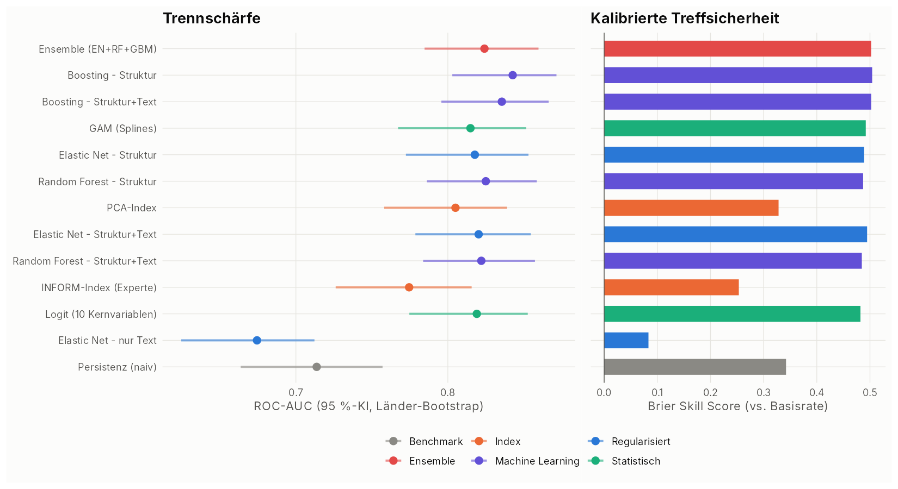
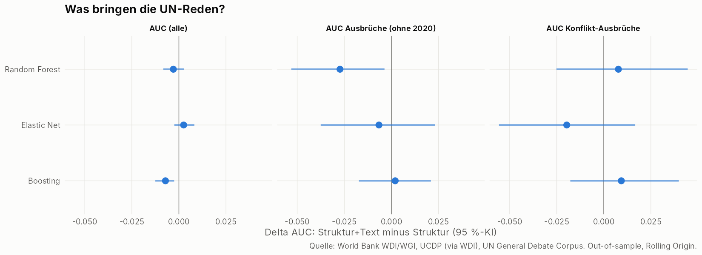
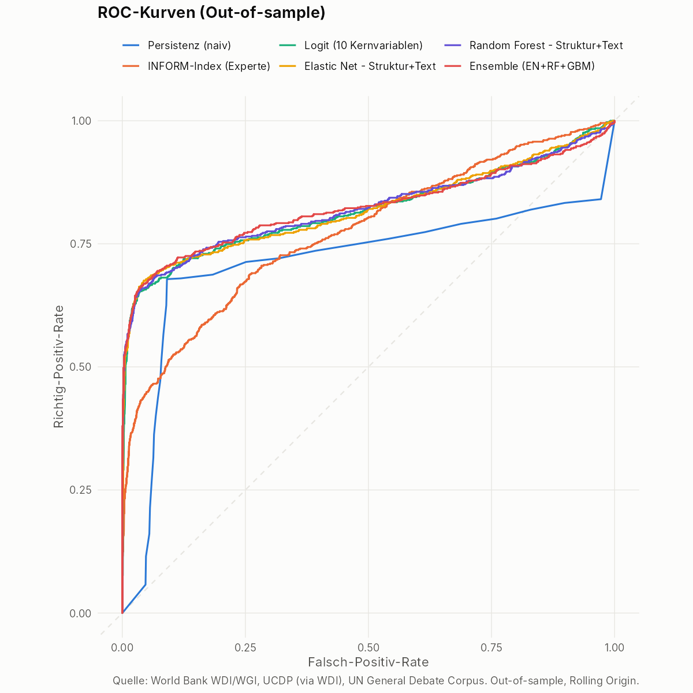
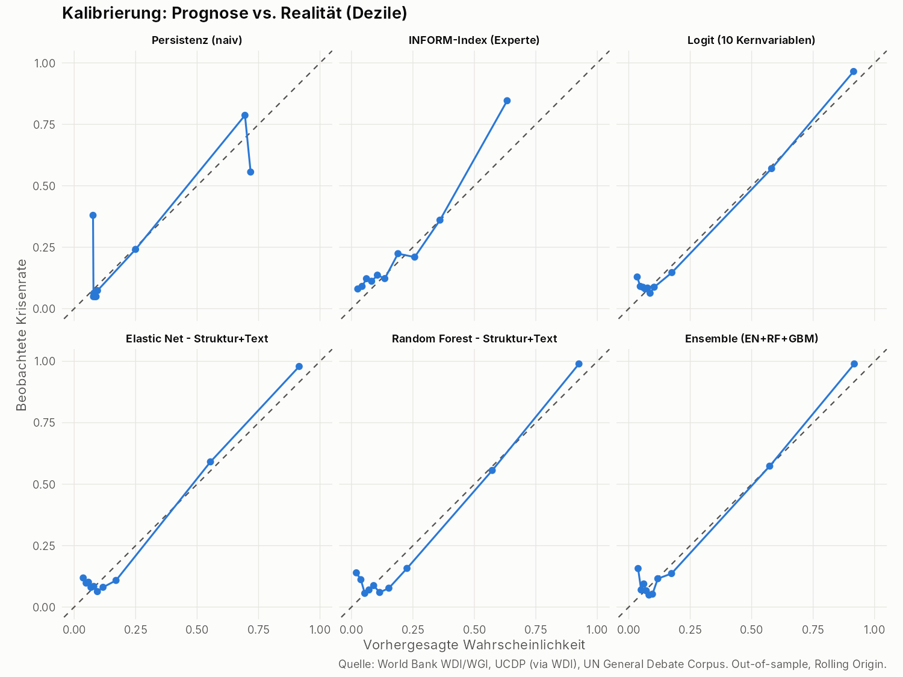
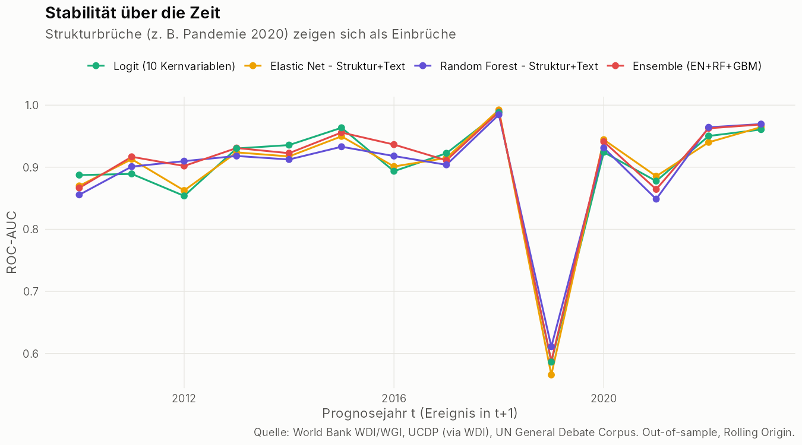
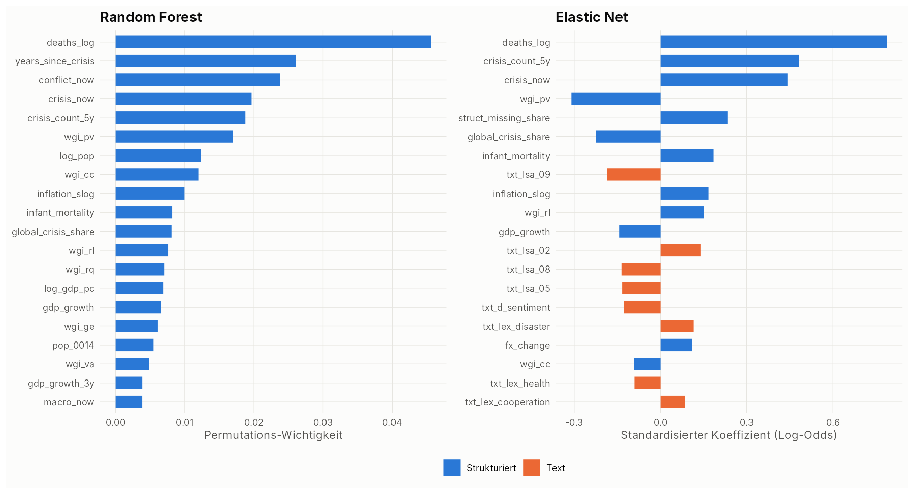
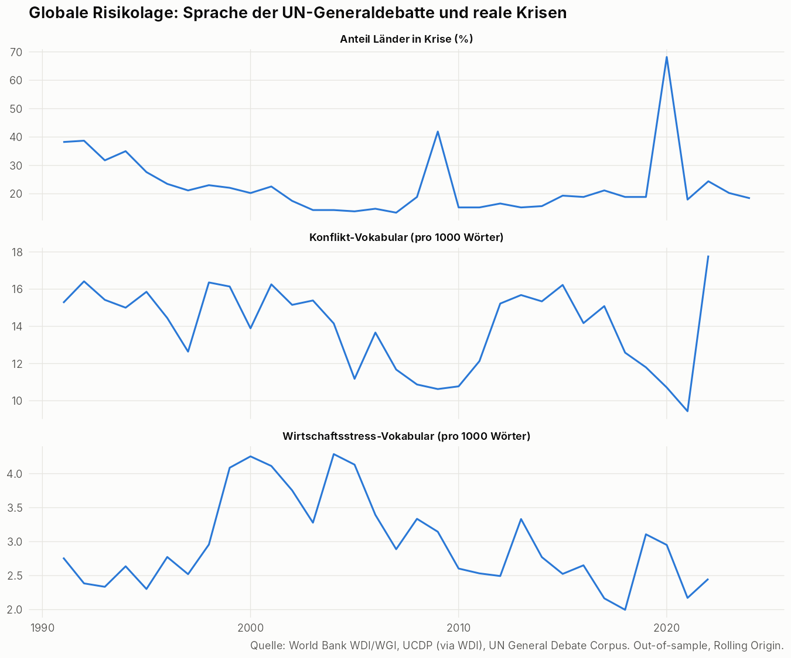
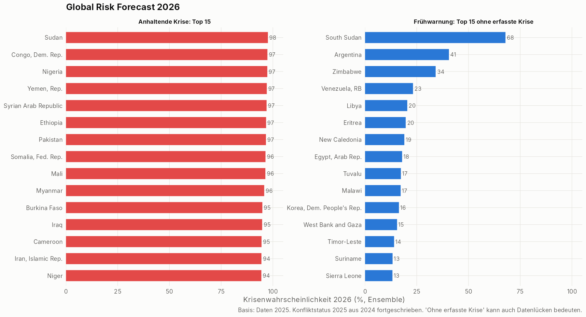

# Global Risk Model - automatischer Evaluationsbericht

_Erzeugt am 06.11.2026. Alle Kennzahlen sind echte Out-of-sample-Werte._

## Datengrundlage

* Länder-Jahre im Modell: **6572** (210 Länder, 1991-2023), Krisenrate 23.7 %
* Out-of-sample-Testjahre: 2010-2023 (Ereignisse 2011-2024), 2864 Vorhersagen pro Methode
* Strukturierte Features: 36, Text-Features: 30

## Methodenvergleich

| Rang | Methode | AUC | AUC 95%-KI | PR-AUC | AUC Ausbrüche* | AUC Konflikt-Ausbr. | Brier | BSS | Kal.-Steigung | Top-10%-Recall | DeLong p vs. Logit |
|---|---|---|---|---|---|---|---|---|---|---|---|
|  1 | Ensemble (EN+RF+GBM) | 0.824 | 0.785-0.860 | 0.786 | 0.699 | 0.740 | 0.089 | 0.502 | 1.036 | 0.434 | 0.362 |
|  2 | Boosting - Struktur | 0.843 | 0.803-0.871 | 0.789 | 0.678 | 0.727 | 0.088 | 0.504 | 0.978 | 0.431 | <0.001 |
|  3 | Boosting - Struktur+Text | 0.836 | 0.796-0.866 | 0.785 | 0.680 | 0.736 | 0.089 | 0.502 | 0.985 | 0.429 | 0.013 |
|  4 | GAM (Splines) | 0.815 | 0.767-0.852 | 0.772 | 0.681 | 0.770 | 0.090 | 0.492 | 0.990 | 0.429 | 0.345 |
|  5 | Elastic Net - Struktur | 0.818 | 0.772-0.853 | 0.771 | 0.677 | 0.730 | 0.091 | 0.489 | 1.006 | 0.429 | 0.692 |
|  6 | Random Forest - Struktur | 0.825 | 0.786-0.859 | 0.785 | 0.697 | 0.686 | 0.091 | 0.487 | 0.851 | 0.431 | 0.364 |
|  7 | PCA-Index | 0.805 | 0.758-0.839 | 0.707 | 0.690 | 0.841 | 0.120 | 0.328 | 0.990 | 0.388 | 0.064 |
|  8 | Elastic Net - Struktur+Text | 0.820 | 0.779-0.855 | 0.775 | 0.670 | 0.710 | 0.090 | 0.495 | 1.030 | 0.429 | 0.762 |
|  9 | Random Forest - Struktur+Text | 0.822 | 0.784-0.857 | 0.780 | 0.669 | 0.694 | 0.092 | 0.485 | 0.933 | 0.436 | 0.645 |
| 10 | INFORM-Index (Experte) | 0.775 | 0.726-0.816 | 0.641 | 0.671 | 0.777 | 0.133 | 0.253 | 1.009 | 0.361 | <0.001 |
| 11 | Logit (10 Kernvariablen) | 0.819 | 0.775-0.853 | 0.768 | 0.674 | 0.703 | 0.092 | 0.482 | 0.969 | 0.426 | - |
| 12 | Elastic Net - nur Text | 0.674 | 0.625-0.712 | 0.417 | 0.592 | 0.743 | 0.163 | 0.083 | 1.069 | 0.228 | <0.001 |
| 13 | Persistenz (naiv) | 0.714 | 0.664-0.757 | 0.465 | 0.505 | 0.453 | 0.117 | 0.342 | 0.917 | 0.343 | <0.001 |

_Rang = Mittel der Ränge aus AUC, PR-AUC, AUC Ausbrüche, AUC Konflikt-Ausbrüche, Brier, |Kalibrierungs-Steigung - 1| und Top-10%-Recall. * Ausbrüche = Länder ohne aktuelle Krise; ohne das Pandemie-Ereignisjahr 2020, das mit rund der Hälfte aller Ausbrüche jede länderspezifische Bewertung dominieren würde._

## Teilaufgaben: Konflikt vs. Makrokrise

| Methode | AUC Konflikt | AUC Makro |
|---|---|---|
| Elastic Net - Struktur+Text | 0.955 | 0.644 |
| Elastic Net - Struktur | 0.956 | 0.637 |
| Elastic Net - nur Text | 0.784 | 0.542 |
| Ensemble (EN+RF+GBM) | 0.959 | 0.650 |
| GAM (Splines) | 0.961 | 0.623 |
| Boosting - Struktur+Text | 0.958 | 0.677 |
| Boosting - Struktur | 0.957 | 0.696 |
| INFORM-Index (Experte) | 0.895 | 0.625 |
| Logit (10 Kernvariablen) | 0.953 | 0.643 |
| PCA-Index | 0.950 | 0.620 |
| Persistenz (naiv) | 0.872 | 0.506 |
| Random Forest - Struktur+Text | 0.954 | 0.651 |
| Random Forest - Struktur | 0.953 | 0.660 |

## Mehrwert der Textdaten

| Methode | Metrik | Delta AUC | KI unten | KI oben | P(Delta>0) |
|---|---|---|---|---|---|
| Elastic Net | AUC (alle) | 0.003 | -0.002 | 0.008 | 0.807 |
| Elastic Net | AUC Ausbrüche (ohne 2020) | -0.007 | -0.038 | 0.023 | 0.283 |
| Elastic Net | AUC Konflikt-Ausbrüche | -0.020 | -0.056 | 0.017 | 0.147 |
| Random Forest | AUC (alle) | -0.003 | -0.008 | 0.003 | 0.160 |
| Random Forest | AUC Ausbrüche (ohne 2020) | -0.027 | -0.053 | -0.004 | 0.013 |
| Random Forest | AUC Konflikt-Ausbrüche | 0.008 | -0.025 | 0.045 | 0.677 |
| Boosting | AUC (alle) | -0.007 | -0.013 | -0.003 | 0.000 |
| Boosting | AUC Ausbrüche (ohne 2020) | 0.002 | -0.017 | 0.021 | 0.583 |
| Boosting | AUC Konflikt-Ausbrüche | 0.009 | -0.018 | 0.040 | 0.747 |

### Interpretation der LSA-Textdimensionen

| dim | negative_pole | positive_pole |
|---|---|---|
| txt_lsa_01 | african, nuclear, terrorism, africa, european, arab, south, iraq | imprisoned, piece, hypocrisy, newspapers, sun, disregarding, homelands, grossly |
| txt_lsa_02 | island, hiv, pacific, mdgs, aids, caribbean, taiwan, sixty | arab, gulf, occupation, kuwait, occupied, israeli, aggression, withdrawal |
| txt_lsa_03 | europe, yugoslavia, european, csce, atlantic, nato, minorities, osce | african, arab, congo, guinea, sudan, hiv, palestinian, aids |
| txt_lsa_04 | apartheid, forty, caribbean, organisation, namibia, haiti, debt, cambodia | terrorism, arab, terrorist, iraqi, iraq, israeli, islamic, kosovo |
| txt_lsa_05 | island, caribbean, islands, saint, pacific, arab, occupation, iraq | african, congo, angola, liberia, burundi, oau, ecowas, leone |
| txt_lsa_06 | american, solidarity, congo, latin, fight, bolivia, colombia, peru | pacific, island, islands, papua, solomon, barbados, sea, nuclear |
| txt_lsa_07 | rwanda, congo, sierra, leone, terrorists, liberia, somalia, cyprus | american, latin, ecuador, peru, chile, bolivia, trafficking, tunisia |
| txt_lsa_08 | korea, korean, organisation, afghanistan, operation, mdgs, people's, peninsula | boutros, fiftieth, bosnia, herzegovina, caribbean, haiti, ghali, emirates |
| txt_lsa_09 | sixty, mdgs, food, climate, moon, d’escoto, brockmann, emissions | terrorist, fifty, attacks, timor, terrorism, korea, johannesburg, globalization |
| txt_lsa_10 | asean, asian, weapon, asia, nuclear, viet, korean, nam | island, turkish, turkey, greece, albania, greek, islands, cyprus |
| txt_lsa_11 | organisation, climate, court, lebanon, mediterranean, arab, zealand, emissions | azerbaijan, armenia, tajikistan, karabakh, uzbekistan, afghan, armenian, kazakhstan |
| txt_lsa_12 | caribbean, saint, caricom, haiti, cyprus, turkish, tobago, trinidad | pacific, guinea, papua, islands, solomon, zealand, australia, ocean |
| txt_lsa_13 | asean, viet, nam, thailand, people’s, china, korea, korean | court, criminal, drug, namibia, personnel, operation, statute, production |
| txt_lsa_14 | saint, tajikistan, forty, afghanistan, soviet, eighth, haiti, kuwait | turkish, turkey, greek, cyprus, cypriots, greece, cypriot, korean |
| txt_lsa_15 | albania, albanian, haiti, herzegovina, bosnia, asean, serbia, kosovo | azerbaijan, armenia, karabakh, nagorny, armenian, minsk, globalization, ukraine |

## Diagnostik

## Prognose 2026

### Höchstes Risiko unter Ländern ohne aktuelle Krise (Frühwarnung)

| Land | Region | Risiko (Ensemble) | Elastic Net | Random Forest | Boosting | INFORM-Index |
|---|---|---|---|---|---|---|
| South Sudan | Sub-Saharan Africa  | 0.679 | 0.543 | 0.595 | 0.898 | 0.683 |
| Argentina | Latin America & Caribbean  | 0.405 | 0.354 | 0.333 | 0.530 | 0.161 |
| Zimbabwe | Sub-Saharan Africa  | 0.341 | 0.222 | 0.320 | 0.482 | 0.422 |
| Venezuela, RB | Latin America & Caribbean  | 0.232 | 0.139 | 0.360 | 0.196 | 0.187 |
| Libya | Middle East, North Africa, Afghanistan & Pakistan | 0.204 | 0.154 | 0.287 | 0.171 | 0.246 |
| Eritrea | Sub-Saharan Africa  | 0.196 | 0.117 | 0.339 | 0.133 | 0.272 |
| New Caledonia | East Asia & Pacific | 0.190 | 0.194 | 0.161 | 0.215 | 0.153 |
| Egypt, Arab Rep. | Middle East, North Africa, Afghanistan & Pakistan | 0.179 | 0.233 | 0.099 | 0.206 | 0.293 |
| Tuvalu | East Asia & Pacific | 0.173 | 0.042 | 0.383 | 0.095 | 0.181 |
| Malawi | Sub-Saharan Africa  | 0.172 | 0.162 | 0.208 | 0.147 | 0.441 |
| Korea, Dem. People's Rep. | East Asia & Pacific | 0.164 | 0.129 | 0.239 | 0.123 | 0.126 |
| West Bank and Gaza | Middle East, North Africa, Afghanistan & Pakistan | 0.155 | 0.136 | 0.173 | 0.154 | 0.488 |
| Timor-Leste | East Asia & Pacific | 0.140 | 0.109 | 0.144 | 0.168 | 0.173 |
| Suriname | Latin America & Caribbean  | 0.133 | 0.188 | 0.105 | 0.106 | 0.234 |
| Sierra Leone | Sub-Saharan Africa  | 0.132 | 0.162 | 0.149 | 0.087 | 0.416 |
